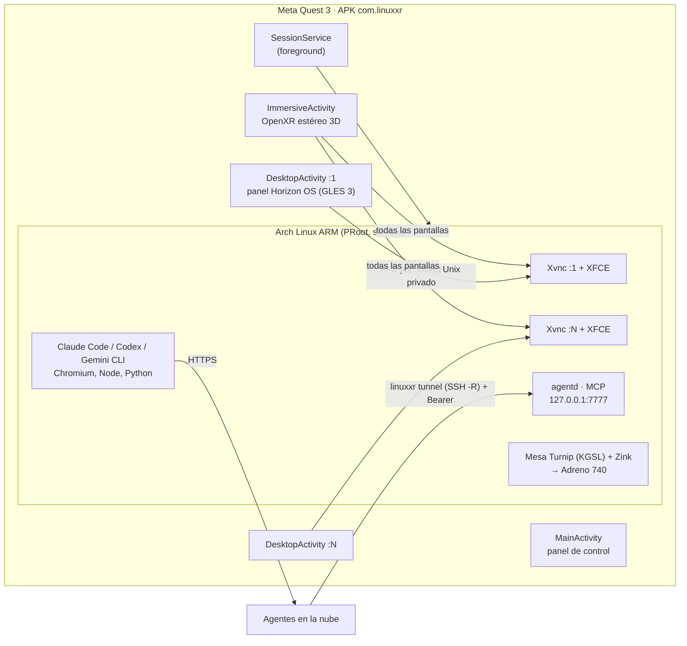

# LinuxXR

Arch Linux ARM dentro de una app para **Meta Quest 3**, con aceleración gráfica, pensada para trabajar con **agentes de IA en la nube**. No está pensada para juegos.



## Cómo funciona

| Pieza | Implementación |
|---|---|
| Linux | Rootfs de Arch Linux ARM (aarch64) fijado por SHA-256 (`proot-distro` v4.34.2). Se descarga en el primer arranque (~164 MB). |
| Emulación | [PRoot](https://github.com/termux/proot) (fork de Termux) compilado con el NDK desde un commit fijado. Se empaqueta como `libproot.so` y `libproot-loader.so`, porque desde API 29 una app no puede ejecutar binarios desde sus datos. Sin root y sin KVM. |
| Escritorios | TigerVNC `Xvnc` + XFCE, uno por display (1–4). Cada uno escucha en `/run/linuxxr/display-N.sock`, un socket Unix privado de la app: ninguna otra app del Quest puede conectarse. |
| Paneles | `DesktopActivity`: cliente RFB propio (Raw, CopyRect, ExtendedDesktopSize) que dibuja con OpenGL ES 3 y solo sube a la textura la zona que cambió. El escritorio remoto se redimensiona al tamaño del panel para que cada píxel sea 1:1. |
| VR inmersivo | `ImmersiveActivity` + `xr_main.cpp` (OpenXR, loader Khronos 1.1.65), estéreo 3D con seguimiento de cabeza. El display `:1` se convierte en un **escritorio de 360°**: 6 monitores RandR de 1440×1200 (8640 px = 24 px/°, un píxel del escritorio por píxel de la pantalla del Quest 3) envueltos a tu alrededor a 1,8 m. Las ventanas se colocan y maximizan en cualquier dirección. Los displays 2–4 flotan encima. Por defecto el fondo es **passthrough**: no hay fondo de escritorio, la ventana raíz de X se pinta con un color clave que se vuelve transparente, así que solo flotan las ventanas en tu habitación. |
| Nitidez | Cada columna del escritorio es una capa `XR_KHR_composition_layer_cylinder` que el compositor de Meta muestrea directamente, sin pasar por el buffer de ojo (que tiene resolución dinámica y foveated), con mipmaps y `XR_FB_composition_layer_settings` (supersampling + sharpening). |
| Entrada | Rayo y gatillo del mando o pinch de las manos → ratón. Joystick → rueda. Teclado del sistema o teclado Bluetooth → keysyms X11. La barra superior tiene Esc, Tab, Ctrl, Alt, Super y Shift (fijos hasta la siguiente tecla), flechas, clic derecho y pegar. |
| GPU | `linuxxr gpu build` compila Mesa 26.2.7 dentro del Quest: Turnip con KMD **KGSL** (`/dev/kgsl-3d0`) y Zink para OpenGL. Se instala en `/opt/linuxxr/mesa`, aparte del Mesa de Arch, así que `pacman -Syu` no lo pisa. |
| Agentes | `agentd` (Python, sin dependencias externas) es un servidor MCP (Streamable HTTP) con estas herramientas: `screenshot`, `click`, `move`, `drag`, `scroll`, `type`, `key`, `run`, `read_file`, `write_file`, `list_displays`. Exige token Bearer y valida `Origin`. |

## Carpeta compartida

Pulsa **Activar carpeta compartida con el Quest** y concede "Acceso a todos los archivos". El almacenamiento del visor (Download, DCIM, Pictures, Oculus/Screenshots, etc.) aparece en Linux como `~/Quest` y como `/sdcard`. Reinicia Linux tras concederlo.

## Compilar

Requisitos: Android SDK con NDK `29.0.14206865` y CMake del SDK, más JDK 17 o superior.

```powershell
.\gradlew.bat assembleDebug          # descarga y verifica proot y talloc, los compila y genera el APK
.\gradlew.bat testDebugUnitTest      # tests del cliente RFB
adb install -r app\build\outputs\apk\debug\app-debug.apk
```

El APK queda en *Biblioteca → Fuentes desconocidas* del Quest.

## Uso

1. Abre **LinuxXR**, elige cuántos escritorios quieres y pulsa **Iniciar Linux**. La primera vez descarga el rootfs y ejecuta `provision.sh`, que hace `pacman -Syu` e instala XFCE, TigerVNC, Chromium, Node, Python, xdotool y demás. Tarda varios minutos.
2. Elige cómo ver los escritorios:
   - **Modo VR inmersivo (3D)**: todos los escritorios a tu alrededor, en estéreo.
   - **Abrir escritorio :N**: cada escritorio es un panel 2D distinto de Horizon OS.

### Controles en VR (mandos Touch)

| Mando | Acción |
|---|---|
| Apuntar | Mueve el puntero (rayo suavizado contra el temblor de la mano) |
| Gatillo | Clic izquierdo (mantener = arrastrar). El puntero se queda quieto 140 ms al pulsar, para que el clic no se desplace |
| Grip (mantener) | Agarra la ventana bajo el rayo y la mueve (Alt+arrastrar), a cualquier punto de los 360° |
| A / X | Clic derecho |
| B / Y | Abre o cierra el teclado virtual |
| Joystick ↑/↓ | Scroll |
| Joystick ←/→ | Gira todo el escritorio 30° |
| Clic joystick izquierdo | Passthrough ↔ entorno virtual |
| Clic joystick derecho | Recentra |
| Teclado Bluetooth | Escribe en el escritorio al que apuntaste por última vez |

### Teclado virtual y dictado

B/Y abre un teclado flotante delante de ti, inclinado como un teclado real. Se pulsa con el rayo y el gatillo, con vibración al pasar por cada tecla. Ctrl, Alt y Super se quedan fijos hasta la siguiente tecla.

**🎤 Dictar** escribe lo que dices en la ventana activa y sigue escuchando hasta que vuelves a pulsar 🎤. Horizon OS no ofrece su reconocedor de voz a apps de terceros, así que LinuxXR usa **Whisper en el propio visor** ([whisper.cpp](https://github.com/ggml-org/whisper.cpp) v1.9.5, modelo multilingüe `small` q5_1, sin nube). La primera vez descarga el modelo (~190 MB, SHA-256 fijado). Corta las frases con un detector de voz por energía: lo dicho se escribe al hacer una pausa. Si el sistema llega a ofrecer un reconocedor, se usa ese con transcripción en directo. El permiso de micrófono se pide al abrir LinuxXR.

## Limitaciones conocidas

- PRoot intercepta las syscalls con ptrace. Las tareas que hacen mucha E/S (compilar, `pacman`) van más lentas que en nativo; el código de usuario corre a velocidad nativa (arm64).
- Xvnc no tiene DRI3. Turnip y Zink renderizan en la GPU, pero presentan copiando por CPU (`MESA_VK_WSI_DEBUG=sw`, `LIBGL_KOPPER_DRI2=true`). Para escritorio, navegador y agentes es suficiente; para juegos no.
- Chromium corre con `--no-sandbox`, porque PRoot no tiene namespaces.
- Las manos sin mandos solo funcionan si el runtime las expone como `khr/simple_controller`.
- Horizon OS puede cerrar la app si se queda sin memoria. La sesión corre en un servicio en primer plano para reducir ese riesgo.

## Licencias

PRoot es GPL-2.0, talloc es LGPL-3.0 y whisper.cpp es MIT. El build los descarga de sus fuentes oficiales con commit/versión y SHA-256 fijados (`app/build.gradle.kts`).
