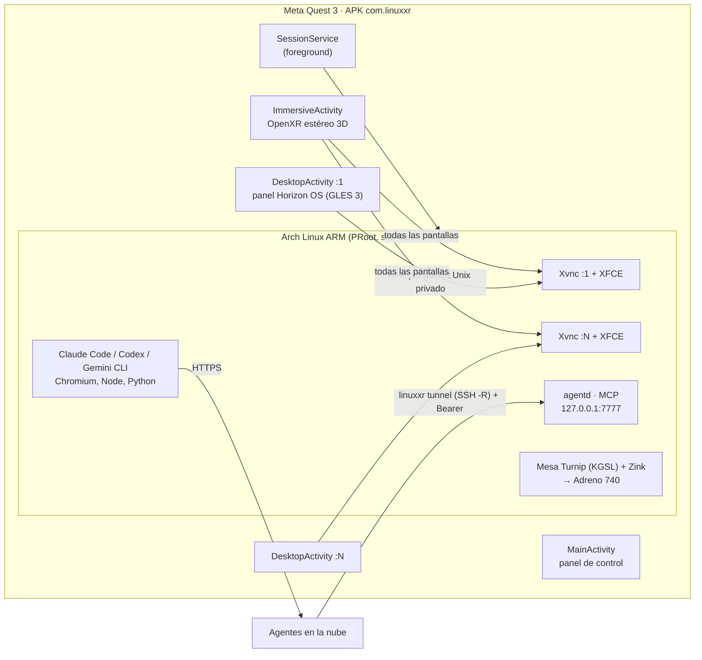

# LinuxXR

Arch Linux ARM dentro de una app para **Meta Quest 3**, con aceleración gráfica, pensada para trabajar con **agentes de IA en la nube**. No está pensada para juegos.



## Cómo funciona

| Pieza | Implementación |
|---|---|
| Linux | Rootfs de Arch Linux ARM (aarch64) fijado por SHA-256 (`proot-distro` v4.34.2). Se descarga en el primer arranque (~164 MB). |
| Emulación | [PRoot](https://github.com/termux/proot) (fork de Termux) compilado con el NDK desde un commit fijado. Se empaqueta como `libproot.so` y `libproot-loader.so`, porque desde API 29 una app no puede ejecutar binarios desde sus datos. Sin root y sin KVM. |
| Escritorios | TigerVNC `Xvnc` + XFCE, uno por display (1–4). Cada uno escucha en `/run/linuxxr/display-N.sock`, un socket Unix privado de la app: ninguna otra app del Quest puede conectarse. |
| Paneles | `DesktopActivity`: cliente RFB propio (Raw, CopyRect, ExtendedDesktopSize) que dibuja con OpenGL ES 3 y solo sube a la textura la zona que cambió. El escritorio remoto se redimensiona al tamaño del panel para que cada píxel sea 1:1. |
| VR inmersivo | `ImmersiveActivity` + `xr_main.cpp` (OpenXR, loader Khronos 1.1.65). Renderiza **por separado cada ojo** con la pose y el FOV de cada uno (estéreo 3D real, con seguimiento de cabeza). Todos los escritorios aparecen como pantallas curvas a 1,8 m, alrededor del usuario, sobre un entorno oscuro con suelo en rejilla. El passthrough (`XR_FB_passthrough`) es opcional. Las texturas son sRGB con mipmaps y filtrado anisotrópico para que el texto se lea bien a distancia. |
| Entrada | Rayo y gatillo del mando o pinch de las manos → ratón. Joystick → rueda. Teclado del sistema o teclado Bluetooth → keysyms X11. La barra superior tiene Esc, Tab, Ctrl, Alt, Super y Shift (fijos hasta la siguiente tecla), flechas, clic derecho y pegar. |
| GPU | `linuxxr gpu build` compila Mesa 26.2.7 dentro del Quest: Turnip con KMD **KGSL** (`/dev/kgsl-3d0`) y Zink para OpenGL. Se instala en `/opt/linuxxr/mesa`, aparte del Mesa de Arch, así que `pacman -Syu` no lo pisa. |
| Agentes | `agentd` (Python, sin dependencias externas) es un servidor MCP (Streamable HTTP) con estas herramientas: `screenshot`, `click`, `move`, `drag`, `scroll`, `type`, `key`, `run`, `read_file`, `write_file`, `list_displays`. Exige token Bearer y valida `Origin`. |

## Compilar

Requisitos: Android SDK con NDK `29.0.14206865` y CMake del SDK, más JDK 17 o superior.

```powershell
.\gradlew.bat assembleDebug          # descarga y verifica proot y talloc, los compila y genera el APK
.\gradlew.bat testDebugUnitTest      # tests del cliente RFB
adb install -r app\build\outputs\apk\debug\app-debug.apk
```

El APK queda en *Biblioteca → Fuentes desconocidas* del Quest.

## Uso

1. Abre **LinuxXR**, elige cuántos escritorios quieres y pulsa **Iniciar Linux**. La primera vez descarga el rootfs y ejecuta `provision.sh`, que hace `pacman -Syu` e instala XFCE, TigerVNC, Chromium, Node, Python, xdotool y demás. Tarda varios minutos.
2. Elige cómo ver los escritorios:
   - **Modo VR inmersivo (3D)**: todos los escritorios a tu alrededor, en estéreo.
   - **Abrir escritorio :N**: cada escritorio es un panel 2D distinto de Horizon OS.

### Controles en VR

| Mando | Acción |
|---|---|
| Apuntar | Mueve el puntero (el láser se apoya en la pantalla) |
| Gatillo | Clic izquierdo (mantener = arrastrar) |
| Grip | Clic derecho |
| Joystick ↑/↓ | Rueda (scroll) |
| A / X | Alterna entre entorno virtual y passthrough (realidad mixta) |
| B / Y | Recentra las pantallas delante de ti |
| Teclado Bluetooth | Escribe en la pantalla a la que apuntaste por última vez |

3. En una terminal de XFCE:

```bash
linuxxr agents install claude codex gemini   # CLIs de agentes (npm global)
linuxxr gpu build                            # una sola vez; compila Mesa en el Quest
linuxxr gpu status                           # comprueba el renderer (tras reiniciar la sesión)
linuxxr token                                # token del puente MCP
linuxxr tunnel usuario@mi-servidor           # publica agentd en mi-servidor:127.0.0.1:7777
```

### Conectar un agente en la nube

En el servidor donde corre el agente, con `linuxxr tunnel` activo:

```bash
claude mcp add --transport http linuxxr http://127.0.0.1:7777/mcp \
  --header "Authorization: Bearer <token>"
```

El agente ve y controla los escritorios (`screenshot` y `click` con `display: ":2"`, etc.) y puede ejecutar comandos en Arch.

## Limitaciones conocidas

- PRoot intercepta las syscalls con ptrace. Las tareas que hacen mucha E/S (compilar, `pacman`) van más lentas que en nativo; el código de usuario corre a velocidad nativa (arm64).
- Xvnc no tiene DRI3. Turnip y Zink renderizan en la GPU, pero presentan copiando por CPU (`MESA_VK_WSI_DEBUG=sw`, `LIBGL_KOPPER_DRI2=true`). Para escritorio, navegador y agentes es suficiente; para juegos no.
- Chromium corre con `--no-sandbox`, porque PRoot no tiene namespaces.
- En VR solo se escribe con teclado Bluetooth. El teclado virtual de Meta no está integrado; para teclear sin teclado físico usa el modo panel. Las manos (sin mandos) solo funcionan si el runtime las expone como `khr/simple_controller`.
- Horizon OS puede cerrar la app si se queda sin memoria. La sesión corre en un servicio en primer plano para reducir ese riesgo.

## Licencias

PRoot es GPL-2.0 y talloc es LGPL-3.0. El build los descarga de sus fuentes oficiales con commit/versión y SHA-256 fijados (`app/build.gradle.kts`).
